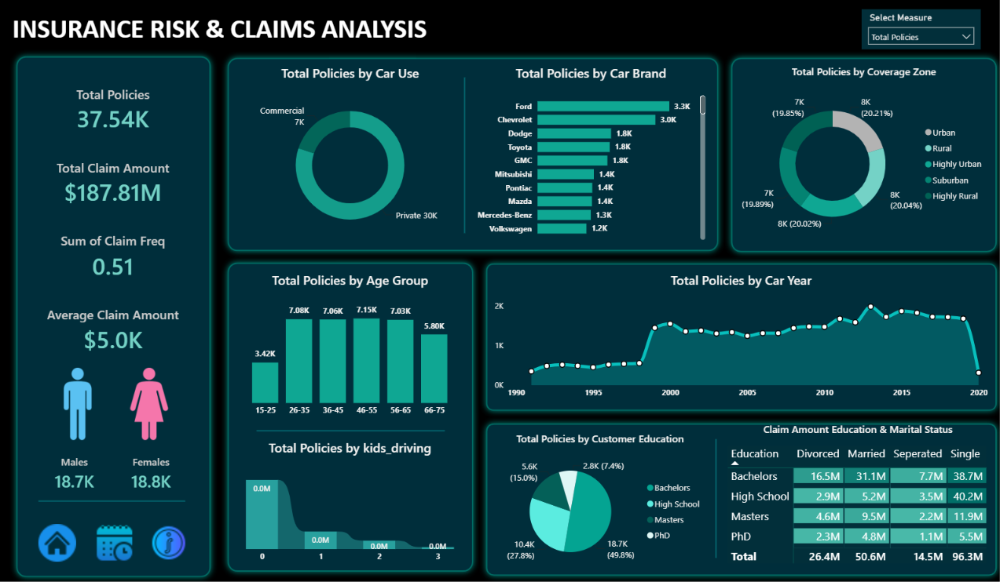

# 🚗 Insurance Risk & Claims Analysis | Power BI Dashboard

An interactive Power BI dashboard that gives an insurance company a single, centralized view of its car-insurance policyholders and claim patterns, so stakeholders can track performance, spot trends, and identify high-risk segments.




---

## 📑 Table of Contents

- [Business Problem](#-business-problem)
- [Objectives](#-objectives)
- [Dataset Overview](#-dataset-overview)
- [Dashboard Features](#-dashboard-features)
- [Key Insights](#-key-insights)
- [Tools & Techniques](#-tools--techniques)
- [Repository Structure](#-repository-structure)
- [How to Use](#-how-to-use)
- [Recommendations](#-recommendations)
- [Author](#-author)

---

## 🎯 Business Problem

An insurance company wants to better understand its policyholder base and claim behaviour to make data-driven decisions. Policy and claims data are scattered across multiple sources, which makes it hard for stakeholders to monitor performance and identify trends.

**Solution:** a centralized, interactive Power BI dashboard covering KPIs and deep-dive charts across customer demographics, vehicle details, and claim behaviour.

---

## ✅ Objectives

- Measure the size of the customer base and the financial impact of claims
- Analyse how often claims are made (**frequency**) and how costly they are (**severity**)
- Segment customers by demographics (gender, age, education, marital status, household driving)
- Identify risk factors linked to the vehicle (make, use, year) and location (coverage zone)
- Support pricing, underwriting, and marketing decisions

---

## 🗂 Dataset Overview

Each record represents one policyholder, their vehicle, and their claim history.

| # | Field | Type | Description |
|---|-------|------|-------------|
| 1 | **ID** | Numeric/Text | Unique identifier for each policy/customer (primary key) |
| 2 | **Birthdate** | Date | Used to calculate age and age groups |
| 3 | **Car Color** | Categorical | Exterior colour of the insured car |
| 4 | **Car Make** | Categorical | Manufacturer/brand (e.g., Ford, Toyota) |
| 5 | **Car Model** | Categorical | Specific model of the car |
| 6 | **Car Use** | Categorical | Primary purpose of the car (Private / Commercial) |
| 7 | **Car Year** | Numeric | Year of manufacture, used to derive car age |
| 8 | **Coverage Zone** | Categorical | Geographic risk area (Urban, Highly Urban, Suburban, Rural, Highly Rural) |
| 9 | **Education** | Categorical | Highest education level attained |
| 10 | **Gender** | Categorical | Gender of the policyholder |
| 11 | **Marital Status** | Categorical | Single, Married, Divorced, Separated |
| 12 | **Parent** | Boolean | Whether the policyholder has children |
| 13 | **Claim Amt** | Numeric (currency) | Total monetary value of claims filed |
| 14 | **Claim Freq** | Numeric (integer) | Number of claims filed |
| 15 | **Household Income** | Numeric | Annual household income |
| 16 | **Kids Driving** | Numeric (integer) | Number of licensed young drivers in the household |

**Derived fields:** Age / Age Group (from Birthdate), Car Age (from Car Year).

---

## 📊 Dashboard Features

All visuals are driven by a **"Select Measure"** slicer that lets the user switch between two dynamic measures:

- **Total Claim Amount**
- **Total Policies**

### KPI Cards

| KPI | Purpose | Value |
|-----|---------|-------|
| **Total Policies** | Size of the active customer base | 37.54K |
| **Total Claim Amount** | Overall financial impact of claims | $187.81M |
| **Claim Frequency** | How often claims are made | 0.51 |
| **Average Claim Amount** | Claim severity / risk exposure | $5.0K |
| **Gender-wise Policies** | Customer distribution by gender | Males 18.7K · Females 18.8K |

### Visualizations

| # | Visual | Chart Type | Purpose |
|---|--------|-----------|---------|
| 1 | By Car Use | Donut chart | Policy and claim split by how cars are used |
| 2 | By Car Make | Bar chart | Brands with the highest policies and claims |
| 3 | By Coverage Zone | Donut chart | Regional risk analysis |
| 4 | By Age Group | Column / histogram | Which age brackets file the most claims |
| 5 | By Car Year | Area chart | Impact of vehicle year on policies and claims |
| 6 | By Kids Driving | Ribbon chart | Impact of young drivers in the household |
| 7 | By Education | Pie chart | Education level vs. policy adoption and claims |
| 8 | By Education & Marital Status | Matrix heat grid | Combined effect on customer profiles |

---

## 🔍 Key Insights

*Based on the **Total Claim Amount** view of the dashboard.*

- **Private cars dominate claims:** Private use accounts for **$150.4M (~80%)** of total claims, versus $37.41M for Commercial.
- **Ford and Chevrolet lead by brand:** Ford (~$17M) and Chevrolet (~$15M) have the highest claim totals, followed by Dodge, Toyota, and GMC (~$9M each).
- **Risk is spread evenly across zones:** Each coverage zone contributes roughly 20% of claims (19.84%–20.35%), so geography alone is not a strong differentiator in this data.
- **Mid-aged drivers drive claim volume:** Ages 26–65 each contribute about $35M, while the 15–25 group ($17.13M) and 66–75 group ($29.10M) are lower.
- **Households with no young drivers account for most claims:** 0 kids driving = **$133.7M**, then 1 kid = $33.7M, 2 kids = $16.4M, 3 kids = $4.1M.
- **Education skew:** Bachelors holders account for **50.1%** of claims ($94.0M), High School 27.6% ($51.8M), Masters 15.1% ($28.3M), and PhD 7.3% ($13.7M).
- **Single customers have the highest claims:** Single = **$96.3M (~51%)**, followed by Married ($50.6M), Divorced ($26.4M), and Separated ($14.5M). Single customers with High School education stand out at **$40.2M**.
- **Balanced gender base:** Male (18.7K) and female (18.8K) policyholders are almost equal.

> ⚠️ **Note:** Claim *totals* by category reflect how many policies each group has as well as risk. Switch the measure to **Total Policies**, or compare against average claim amount, to separate group size from true risk before drawing pricing conclusions.

---

## 🛠 Tools & Techniques

- **Power BI Desktop**: data modelling, visuals, and interactivity
- **DAX**: measures such as Total Policies, Total Claim Amount, Average Claim Amount, Claim Frequency
- **Power Query**: data cleaning and creating derived columns (Age Group, Car Age)
- **Field Parameters / Slicer**: dynamic "Select Measure" switch
- **Design:** dark theme with teal accents, card-style layout, and navigation icons

---

## 📁 Repository Structure

```
Insurance-Risk-Claims-Analysis/
│
├── 📄 README.md
├── 📊 Insurance_Risk_Claims_Analysis.pbix      # Power BI dashboard file
├── 📂 data/
│   └── insurance_data.csv                      # Dataset
├── 📂 docs/
│   ├── Business_Requirements.pdf               # Business requirement document
│   └── Domain_Document.pdf                     # Data dictionary / domain document
└── 📂 images/
    └── dashboard.png                           # Dashboard screenshot
```


---

## ▶️ How to Use

1. **Clone** the repository:
   ```bash
   git clone git@github.com:Aminsfwt/Insurance-Risk-Claims-Analysis-Report.git
   ```
2. Install **Power BI Desktop** (free, Windows).
3. Open the `.pbix` file from the repository.
4. If prompted, update the data source path to point to the dataset in the `data/` folder (*Home → Transform data → Data source settings*).
5. Use the **Select Measure** dropdown and click any chart element to cross-filter the whole dashboard.

---

## 💡 Recommendations

1. **Normalize risk metrics:** add average claim per policy and claim frequency by segment to compare groups fairly.
2. **Review commercial vs. private pricing:** Private cars carry the bulk of claim cost, so check loss ratios per policy for both segments.
3. **Monitor high-claim brands** such as Ford and Chevrolet, with a model-level drill-down for underwriting.
4. **Target the Single customer segment**, the largest source of claims, with risk-based pricing and retention offers.
5. **Investigate the 2020 drop** in the Car Year chart (likely incomplete data for the newest model year) before drawing conclusions about new vehicles.

---

## 👤 Author

**Your Name**
- LinkedIn: [Amin Safout Ali](https://linkedin.com/in/aminsafoutali)
- Power BI Service: [Insurance Risk & Claims Analysis Dashboard](https://app.powerbi.com/view?r=eyJrIjoiYmMxY2M0ZmItYmZmNi00YzczLTg2OWMtZDlhOWRlOTJlNDBjIiwidCI6IjM3ODljOWY3LWM4NDEtNGMyMi1hZjVhLTQ5MWRhOTk5MWQ4NiJ9)


Business requirement and domain documents by **Swapnjeet S** ([Data Tutorials](https://www.youtube.com/@datatutorials1)).

---

